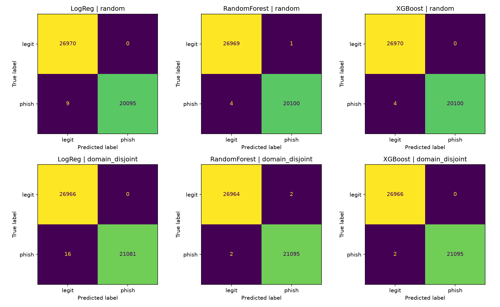
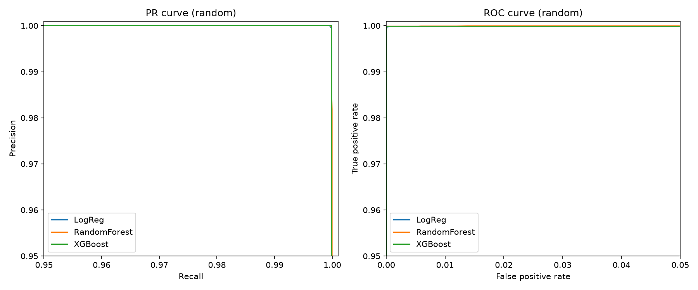
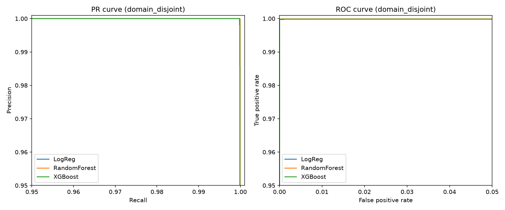
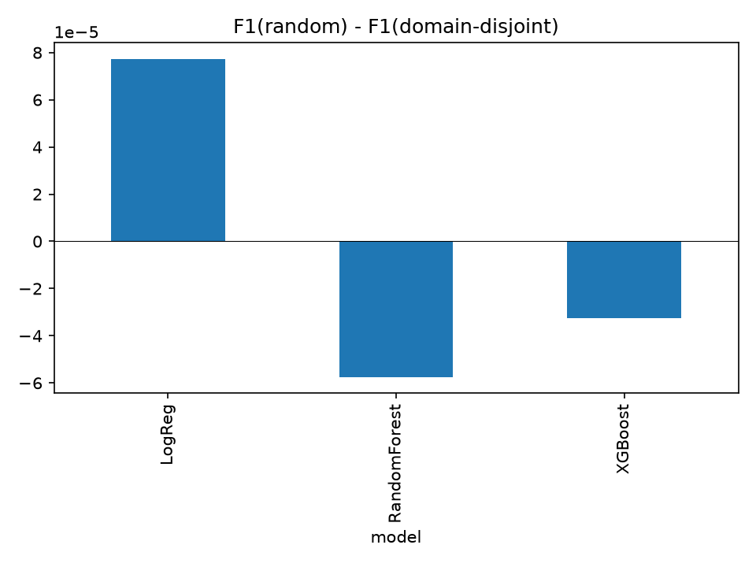
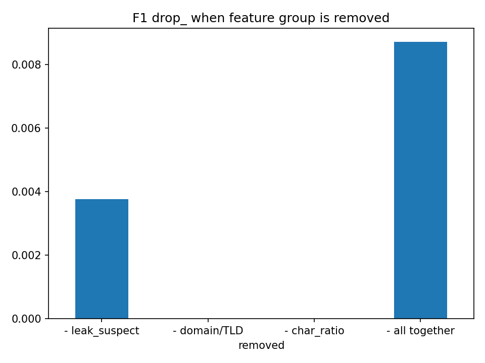
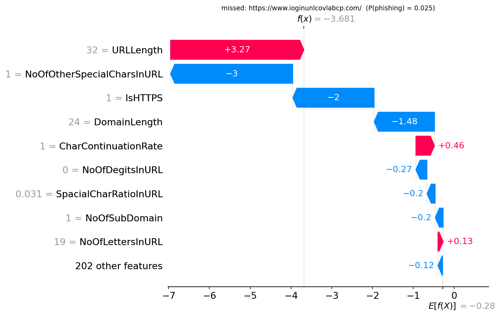

# PhishGuard: Explainable Phishing URL Detection

**Live app: [phishguard-xai.streamlit.app](https://phishguard-xai.streamlit.app/)**

## Overview

PhishGuard is a machine learning project that detects phishing URLs using features extracted directly from URL strings. It investigates whether phishing detection models can generalize to registered domains they have never encountered during training and uses SHAP to explain individual predictions.

The project compares three classification models under random and domain-disjoint evaluation settings, investigates potentially misleading dataset features through feature-group ablation, and provides an interactive Streamlit application for URL classification.

**The central idea:** A model performing well on a random test split does not necessarily mean it can detect phishing on genuinely unseen domains. PhishGuard investigates this distinction rather than relying on accuracy alone.

## Table of Contents

* [Problem Statement](#problem-statement)
* [Dataset](#dataset)
* [Project Workflow](#project-workflow)
* [Phase 1: Data Preparation and Analysis](#phase-1-data-preparation-and-analysis)
  * [Data Cleaning](#1-data-cleaning)
  * [Exploratory Data Analysis](#2-exploratory-data-analysis)
  * [Registered-Domain Preprocessing](#3-registered-domain-preprocessing)
* [Phase 2: Model Development and Evaluation](#phase-2-model-development-and-evaluation)
  * [Part A: Model Comparison](#part-a-model-comparison)
  * [Part B: Feature Ablation and SHAP](#part-b-feature-ablation-and-shap)
  * [Final Model](#final-model)
* [Streamlit Application](#streamlit-application)
* [Repository Structure](#repository-structure)
* [Installation and Setup](#installation-and-setup)
* [Running the Project](#running-the-project)
* [Limitations](#limitations)
* [Conclusion and Future Work](#conclusion-and-future-work)
* [Team](#team)

## Problem Statement

Phishing URL detection systems can report extremely high performance when evaluated using random train-test splits. However, URLs belonging to the same registered domain may appear in both training and testing data. This can make it difficult to determine whether a model has learned meaningful phishing patterns or has benefited from similarities between previously encountered domains.

PhishGuard investigates the following research question:

> Can a phishing URL classifier generalize to registered domains never seen during training, and can its predictions be explained using meaningful URL characteristics?

To investigate this, the project:

* Trains and compares Logistic Regression, Random Forest, and XGBoost.
* Evaluates models using both random and domain-disjoint splits.
* Investigates potentially misleading features through ablation.
* Uses SHAP to interpret model predictions.
* Provides a web application for classifying URLs and displaying explanations.

## Dataset

**Dataset:** [PhiUSIIL Phishing URL Dataset](https://archive.ics.uci.edu/dataset/967/phiusiil+phishing+url+dataset)

**Source:** UCI Machine Learning Repository (Dataset ID: 967)

| Description             | Details |
| ----------------------- | ------- |
| Original records        | 235,795 |
| Original columns        | 56      |
| Records after cleaning  | 235,370 |
| Phishing URLs           | 100,520 |
| Legitimate URLs         | 134,850 |
| Predictive URL features | 23      |

The original dataset contains URL-related and webpage-related information. Since PhishGuard focuses on URL-based detection, webpage and HTML-related features were removed.

**Target variable:** `is_phishing`

- `0`: Legitimate
- `1`: Phishing

The model uses URL characteristics and does not fetch or analyze live webpage content.

## Project Workflow

PhishGuard is organized into three main stages:

1. **Phase 1 – Data preparation:** Cleaning, exploratory analysis, and registered-domain extraction.
2. **Phase 2 – Model development:** Model comparison, domain-disjoint evaluation, feature ablation, and SHAP explainability.
3. **Application – Deployment:** URL feature extraction, prediction, and explanation through a Streamlit interface.

## Phase 1: Data Preparation and Analysis

Phase 1 prepares the dataset for model development and evaluation through three stages: data cleaning, exploratory data analysis, and registered-domain preprocessing.

### 1. Data Cleaning

**Notebook:** `notebooks/01_cleaning.ipynb`
**Input:** raw PhiUSIIL CSV (downloaded from UCI)
**Output:** `data/cleaned.csv`, `data/feature_groups.json`, `data/cleaning_log.json`

| Step              | Result                                                  | Action                                         |
| ----------------- | ------------------------------------------------------- | ---------------------------------------------- |
| Target recoding   | Raw `label` is inverted (1 = legitimate)              | Replaced with `is_phishing` (1 = phishing)   |
| Missing values    | None                                                    | Nothing dropped or imputed                     |
| Formatting        | No fixes needed; 2 mojibake URLs                        | Kept as they are                               |
| Validity checks   | 493 rows where `IsHTTPS` did not match the URL scheme | Corrected from the scheme                      |
| Duplicate URLs    | 425 repeated URLs, all phishing, no label conflicts     | Kept first copy, dropped 425 rows              |
| Outliers          | Mostly phishing (e.g. very long URLs)                   | Kept; transform later using training data only |
| Feature selection | 30 webpage/HTML columns, `Title` and `FILENAME`     | Dropped; only URL-based features kept          |

**Leakage check:** all legitimate URLs are bare `https://www.<domain>` homepages with HTTPS, while phishing URLs are far more varied. `URLSimilarityIndex`, `TLDLegitimateProb`, `URLCharProb` and `IsHTTPS` are therefore tagged `leak_suspect` in `feature_groups.json`.

**Result:** 235,795 rows and 56 columns reduced to 235,370 rows and 26 columns (100,520 phishing, 134,850 legitimate).

**Output:** `data/cleaned.csv`

### 2. Exploratory Data Analysis (EDA)

**Notebook:** `notebooks/02_eda.ipynb`
**Input:** `data/cleaned.csv`
**Output:** plots in `images/`

The EDA examines the 22 numeric URL-only features of the cleaned dataset (235,370 records) before modelling. The notebook has a written observation under each plot.

#### Analyses performed

| Analysis                          | Figure                                |
| --------------------------------- | ------------------------------------- |
| Class balance                     | `images/01_class_balance.png`       |
| Feature distributions by class    | `images/02_distributions.png`       |
| Boxplots of key features by class | `images/03_boxplots.png`            |
| Correlation heatmap (Pearson)     | `images/04_correlation_heatmap.png` |
| Single-feature ROC-AUC            | `images/05_single_feature_auc.png`  |

#### Key findings

- **Class balance:** 134,850 legitimate (57.3%) and 100,520 phishing (42.7%) URLs. The imbalance is mild, so evaluation uses stratified splits and class-aware metrics (phishing recall, F1, PR-AUC) and not accuracy.
- **Discriminative features:** `URLSimilarityIndex` separates the classes almost completely (single-feature AUC 0.996, Pearson r = -0.86 with `is_phishing`). Next are `NoOfOtherSpecialCharsInURL` (0.823), `SpacialCharRatioInURL` (0.807), `URLCharProb` (0.768), `IsHTTPS` (0.757) and `CharContinuationRate` (0.743). Phishing URLs tend to be longer and contain more digits and special characters.
- **Weak features:** obfuscation features, `IsDomainIP`, `NoOfAmpersandInURL` and `NoOfSubDomain` have AUC near 0.50 individually.
- **Redundancy:** `NoOfLettersInURL` and `URLLength` are the only pair above |r| = 0.85 (0.956). The count features move together, and the three obfuscation features are near-duplicates.
- **Suspiciously strong features:** `URLSimilarityIndex`, `IsHTTPS`, `URLCharProb` and `TLDLegitimateProb` may reflect how the dataset was built and not phishing behaviour. They are candidates for the Phase 2 ablation, and models should be reported with and without them.
- **Domain repetition:** at hostname level (the `Domain` column) there are 220,086 unique domains across 235,370 rows, and 54 hostnames appear with both classes. Repeated domains are concentrated in file-hosting and gateway services such as `ipfs.io` and `docs.google.com`. Registered-domain level analysis is in Section 3 and gives different counts because registered domains group subdomains together.
- **TLD skew:** `.app`, `.co`, `.io` and `.ru` are mostly phishing, while `.uk`, `.org`, `.au` and `.de` are mostly legitimate.

### 3. Registered-Domain Preprocessing

This stage extends the cleaned dataset by extracting registered domains from URLs. The extracted domains are used for domain-level analysis and to support domain-disjoint evaluation in Phase 2.

**Notebook:** `notebooks/03_preprocessing.ipynb`

#### Preprocessing Steps

1. **TLD standardization:** Converted TLD values to lowercase and removed surrounding whitespace.
2. **Registered-domain extraction:** Used `tldextract` and the Public Suffix List, including its private-domain entries, to extract registered domains.
3. **IP address handling:** Preserved IP addresses when URLs used IP addresses instead of domain names.
4. **Validation:** Checked for missing or empty extracted domains and identified URLs using IP addresses.
5. **Domain analysis:** Examined domain frequency, repeated domains and domains associated with both target classes.

The original URL values were retained, and the extracted values were added as a separate `registered_domain` column.

#### Domain Analysis Findings

The processed dataset contains the following domain-level observations:

| Observation                           | Result  |
| ------------------------------------- | ------- |
| URL records                           | 235,370 |
| Unique extracted domains              | 197,301 |
| Domains appearing more than once      | 7,463   |
| Domains associated with both classes  | 106     |
| URLs using IP addresses               | 606     |
| Records belonging to repeated domains | 19.34%  |

These findings show that multiple URLs can belong to the same extracted domain, and some domains occur in both target classes.

A random train-test split may place URLs from the same domain in both training and testing sets. Domain-disjoint evaluation is therefore important for assessing generalization to previously unseen domains.

#### Output

`data/cleaned_with_domains.csv`

The processed dataset retains the cleaned features and adds the `registered_domain` column. This column is intended for grouping and evaluation, rather than as a predictive input feature.

## Phase 2: Model Development and Evaluation

Phase 2 evaluates different machine learning models, investigates their ability to generalize to unseen domains, and examines which feature groups contribute to their predictions.

### Part A: Model Comparison

### Setup

- Data: `data/cleaned_with_domains.csv`. Run `python -m src.add_domains` first to generate it from `cleaned.csv` (adds `registered_domain` via `tldextract`).
- Splits: stratified random 80/20, and domain-disjoint (grouped by `registered_domain`, 175,509 groups, no domain in both train and test).
- Models: Logistic Regression (scaled), Random Forest, XGBoost. Encoders and scalers are fit on the training split only (inside a `Pipeline`).
- Run: `python -m src.train_models`, then `python -m src.plots`.

### Metrics

| model        | split           | precision | recall |     f1 | macro_f1 |    fnr | pr_auc | roc_auc |
| :----------- | :-------------- | --------: | -----: | -----: | -------: | -----: | -----: | ------: |
| LogReg       | random          |         1 | 0.9996 | 0.9998 |   0.9998 | 0.0004 | 0.9999 |  0.9999 |
| RandomForest | random          |         1 | 0.9998 | 0.9999 |   0.9999 | 0.0002 |      1 |       1 |
| XGBoost      | random          |         1 | 0.9998 | 0.9999 |   0.9999 | 0.0002 |      1 |  0.9999 |
| LogReg       | domain_disjoint |         1 | 0.9994 | 0.9997 |   0.9998 | 0.0006 |      1 |       1 |
| RandomForest | domain_disjoint |         1 | 0.9999 | 0.9999 |   0.9999 | 0.0001 |      1 |       1 |
| XGBoost      | domain_disjoint |         1 | 0.9999 | 0.9999 |   0.9999 | 0.0001 | 0.9999 |  0.9999 |

### Figures






### Analysis

**Best model.** Random Forest and XGBoost tie on the domain-disjoint split: 2 errors out of 41,889 test URLs (0 false positives, 2 false negatives), F1 0.9999. Logistic Regression has 9 false negatives (F1 0.9997). The tree models differ by a couple of samples at most, so I do not claim a meaningful ranking between them. FNR is the metric that matters most here: 0.0001 for the tree models versus 0.0006 for Logistic Regression.

**Random vs domain-disjoint gap.** F1(random) - F1(domain-disjoint) is +0.00008 for Logistic Regression, -0.00006 for Random Forest and -0.00003 for XGBoost. All are within noise, so grouping by registered domain did not reveal memorization of domains. This should not be read as strong generalization. The features separate the classes almost trivially (`URLSimilarityIndex` alone has AUC 0.996, and every legitimate URL is a bare `https://www.<domain>` homepage), and three features (`URLSimilarityIndex`, `TLDLegitimateProb`, `URLCharProb`) were computed over the full dataset. Part B tests this directly. Caveat: the domain-disjoint test set is 35.7% phishing versus 44.2% in train, because large hosting platforms (`web.app`, `firebaseapp.com`, `repl.co`) moved as single blocks.

**Where it fails.** On the domain-disjoint split, XGBoost and Random Forest each miss only 2 of 14,943 phishing URLs, and neither flags a legitimate URL. Both misses (`https://www.officested.com` and `https://www.eauctionsindia.com/`) are bare `https://www.<domain>` homepages with `URLSimilarityIndex` = 100, HTTPS = 1 and a `.com` TLD. These are exactly the values typical of the legitimate class (median similarity 100, median HTTPS 1, versus 54 and 0 for phishing). The model assigned them phishing probabilities of 0.00008 and 0.000003, so they are confident errors rather than borderline cases, and lowering the decision threshold would not recover them. A phishing page that mimics a clean homepage with a valid certificate is invisible to a URL-string feature set. Telling such pages apart would need page-content or host-level evidence (domain age, WHOIS, certificate details).

**How to improve.**

1. Remove the leak-suspect features and retrain (Part B).
2. Add content-based or host-based features (page content, domain age, certificate data), since URL-string features alone are artifact-prone.
3. Use `GroupKFold` instead of a single split for stable estimates.
4. Evaluate on data from a different source or time period.
5. Threshold tuning helps only for borderline cases; it would not recover the confident misses above.

### Part B: Feature Ablation and SHAP

### Setup

- Model: XGBoost (best in Part A), domain-disjoint split, same seed as Part A.
- In order for XGBoost to treat zeros as zeros rather than as missing values, the preprocessor produces a dense matrix (`sparse_threshold=0`). This maintains SHAP values in line with the model's predictions.
- Run: `python -m src.ablation`, `python -m src.final_model`, `python -m src.explain`.

### Feature-group ablation (domain-disjoint split)

| Removed group    | Features left | F1     | FNR    | F1 drop |
| ---------------- | ------------- | ------ | ------ | ------- |
| none (baseline)  | 23            | 0.9998 | 0.0003 | –      |
| leak_suspect     | 19            | 0.9961 | 0.0061 | 0.0038  |
| domain/TLD       | 17            | 0.9998 | 0.0003 | 0.0000  |
| char_ratio       | 17            | 0.9998 | 0.0003 | 0.0000  |
| all three groups | 9             | 0.9911 | 0.0111 | 0.0087  |



- The only significant change is the removal of the leak-suspect characteristics, which causes missed phishing to increase by almost 20 times (FNR 0.0003 to 0.0061).
- Because the other elements convey the same information, eliminating domain/TLD or character-ratio features by themselves has no effect.
- F1 is 0.991 even with just 9 count-style features remaining. Since every legitimate URL in the dataset is a simple `https://www.<domain>` homepage,
  URL length and special-character counts by themselves do not distinguish the classes, hence this is not proof of strong generalization.

### Final model

XGBoost saved to `models/final_model.joblib`, sans `URLSimilarityIndex`, `URLCharProb`, and
 `TLDLegitimateProb`. Precision 0.9995, recall 0.9946, F1 0.9970, FNR 0.0054, and PR-AUC 0.9992 (105 missed phishing,
10 false alarms out of 46,104 URLs) on the domain-disjoint test set.

### SHAP



- The strongest indicators are the frequency of special characters and URL length (both higher for phishing), `IsHTTPS` (no HTTPS pushes toward phishing), and `DomainLength` (short domains push toward phishing). 
- As per the design, `IsHTTPS` remains in the final model; however, since all legitimate URLs use HTTPS, it is a leak-suspect feature.

| Case       | URL                                                | P(phishing) | Main reasons                                        |
| ---------- | -------------------------------------------------- | ----------- | --------------------------------------------------- |
| Caught     | `https://topaka.cloud/ob52gtplj/18snwp`          | 1.000       | long URL, short domain, path with random characters |
| Missed     | `https://www.kidzcommunity.org`                  | 0.0003      | HTTPS, few special characters, `.org` TLD         |
| Legitimate | `https://www.yeolderoseandcrowntheatrepub.co.uk` | 0.00004     | long domain, short URL, `.uk` TLD                 |

The missed URL shows the main limitation: A URL-only model cannot detect a phishing site housed on a clean-looking homepage using HTTPS since there is no suspicious signal in the URL string.

### Part C: Application and Testing

#### Streamlit Application

**Live application:**[https://phishguard-xai.streamlit.app/](https://phishguard-xai.streamlit.app/)

**Implementation:**

* `app/app.py`
* `src/url_features.py`
* `notebooks/06_app_testing.ipynb`

PhishGuard includes an interactive Streamlit application that allows users to enter a URL and receive a phishing classification with an explanation of the model's decision.

##### How it works

1. The user enters a URL into the application.
2. The application extracts the required URL-based features.
3. The saved XGBoost model predicts whether the URL is phishing or legitimate.
4. The application displays the predicted class and associated probabilities.
5. A SHAP waterfall plot explains the features contributing to the prediction.
6. The extracted feature values are displayed for inspection.

##### URL feature extraction

The feature extractor in `src/url_features.py` provides two feature sources:

* **Existing dataset URLs:** Original feature values are retrieved when the submitted URL matches a URL in the dataset.
* **New URLs:** Features are calculated directly from the submitted URL using the implemented extraction logic.

The extractor was tested against 1,000 dataset URLs, covering 20,000 feature-value comparisons. It achieved **93.47% agreement** with the dataset's original feature values.

The remaining differences occur because some of the dataset authors' feature-counting rules are not fully documented. Consequently, feature calculations for URLs outside the dataset are approximate.

#### Application testing

The application and feature extraction workflow were tested in `notebooks/06_app_testing.ipynb`.

Testing covered:

* Feature extraction and expected feature columns.
* Comparison between calculated features and original dataset values.
* Model prediction using extracted features.
* Handling of missing feature values.
* Streamlit application startup and health checks.

The validation results are documented in the application-testing notebook.

## Repository Structure

```text
PhishGuard/
│
├── app/
│   └── app.py
│
├── data/
│   ├── cleaned.csv
│   ├── cleaned_with_domains.csv
│   ├── cleaning_log.json
│   └── feature_groups.json
│
├── images/
│   ├── 01_class_balance.png
│   ├── 02_distributions.png
│   ├── 03_boxplots.png
│   ├── 04_correlation_heatmap.png
│   └── 05_single_feature_auc.png
│
├── models/
│   └── final_model.joblib
│
├── notebooks/
│   ├── 01_cleaning.ipynb
│   ├── 02_eda.ipynb
│   ├── 03_preprocessing.ipynb
│   ├── 04_modeling.ipynb
│   ├── 05_ablation_shap.ipynb
│   └── 06_app_testing.ipynb
│
├── results/
│   ├── figures/
│   ├── metrics.csv
│   ├── f1_gap.csv
│   └── ablation.csv
│
├── src/
│   ├── common.py
│   ├── add_domains.py
│   ├── train_models.py
│   ├── plots.py
│   ├── ablation.py
│   ├── final_model.py
│   ├── explain.py
│   ├── error_analysis.py
│   └── url_features.py
│
├── run_check.py
├── requirements.txt
└── README.md
```

## Installation and Setup

1. Clone the repository:

```bash
git clone https://github.com/umaimaa-shahid/PhishGuard.git
cd PhishGuard
```

2. Create a virtual environment (recommended)

```Shell
python -m venv .venv
```

Activate it:

**Windows PowerShell:**

```powershell
.venv\Scripts\Activate.ps1
```

**Linux/macOS:**

```bash
source .venv/bin/activate
```

3. Install dependencies:

```bash
pip install -r requirements.txt
```

## Running the Project

### Run the Streamlit application

From the repository root:

```bash
streamlit run app/app.py
```

The application will be available at:

```text
http://localhost:8501
```

The application requires the saved model and cleaned dataset available in the repository.

### Reproduce Phase 2 results

Run the following commands from the repository root:

```bash
python -m src.add_domains
python -m src.train_models
python -m src.plots
python -m src.ablation
python -m src.final_model
python -m src.explain
```

These scripts generate the registered-domain dataset, model evaluation results, visualizations, ablation results, final model, and SHAP explanations.

### Run the notebooks

The notebooks can also be used to follow the project's workflow:

| Order | Notebook                   | Purpose                             |
| ----- | -------------------------- | ----------------------------------- |
| 1     | `01_cleaning.ipynb`      | Dataset cleaning                    |
| 2     | `02_eda.ipynb`           | Exploratory data analysis           |
| 3     | `03_preprocessing.ipynb` | Registered-domain extraction        |
| 4     | `04_modeling.ipynb`      | Model training and comparison       |
| 5     | `05_ablation_shap.ipynb` | Feature ablation and explainability |
| 6     | `06_app_testing.ipynb`   | Application testing and validation  |

To reproduce Phase 1 from scratch, first download the original dataset from the [UCI repository](https://archive.ics.uci.edu/dataset/967/phiusiil+phishing+url+dataset) and place it at the input path expected by the cleaning notebook.

## Limitations

The results should be interpreted in the context of the dataset and the project's URL-only scope.

1. Dataset construction: All legitimate URLs in the dataset are bare
   `https://www.example.com` homepages, while phishing URLs have
   more varied structures.
2. Potential feature leakage: Some dataset-provided features were calculated using information from the full dataset. Their contribution was investigated through feature ablation, and the final model excludes three of these features.
3. Domain-disjoint evaluation: Most registered domains appear only once. Consequently, random and domain-disjoint splits are relatively similar, and a small generalization gap does not establish real-world generalization.
4. URL-only detection: Phishing websites hosted on clean-looking HTTPS homepages may be difficult to detect using URL characteristics alone.
5. Approximate feature extraction: The dataset authors' exact counting rules are not fully documented. Features recalculated for URLs outside the dataset may therefore differ from the original dataset's values.
6. Different evaluation sets: Part A and Part B used registered-domain files generated with different Public Suffix List settings, so their test-set sizes differ (41,889 versus 46,104 URLs).
7. External validation: Performance on a single dataset does not establish performance on newer phishing campaigns or URLs from different sources.

## Conclusion and Future Work

PhishGuard demonstrates how machine learning, domain-disjoint evaluation, feature ablation, and explainability can be combined to investigate phishing URL detection.

The experiments show that all three evaluated models achieved near-perfect scores on the PhiUSIIL dataset. However, the analysis also revealed that these results are influenced by the dataset's structure and potentially misleading features.

The final XGBoost model, trained without three leak-suspect features, achieved an F1-score of 0.9970 on the domain-disjoint test set. SHAP explanations further demonstrated that phishing URLs resembling legitimate homepages remain a significant challenge for URL-only detection.

**Future improvements include:**

* Developing a shared feature extraction pipeline for both model training and application inference.
* Improving feature consistency for URLs outside the original dataset.
* Incorporating host-based features such as domain age and certificate information.
* Evaluating the model using recent phishing URLs from external sources such as PhishTank and OpenPhish.
* Testing on legitimate URLs containing paths and query parameters, rather than only homepage-style URLs.

PhishGuard highlights the importance of evaluating not only how accurately a model classifies data, but also what patterns it learns and how reliably those patterns apply beyond the dataset on which it was trained.

## Team

| Name          | Student ID | Contribution                                                                                                                        |
| ------------- | ---------- | ----------------------------------------------------------------------------------------------------------------------------------- |
| Ayesha Arshad | 23L-2596   | Phase 1: Data cleaning, Phase 2: Model Training                                                                                    |
| Esar Fatima   | 23L-0888   | Phase 1: Exploratory Data Analysis, Phase 2: Feature Ablation and SHAP                                                            |
| Umaima Shahid | 23L-0893   | Phase 1: Registered-domain extraction, preprocessing and domain analysis, Phase 2: Streamlit Application, Testing, and Deployment |
